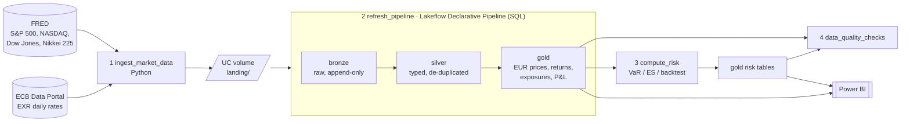

# Market Risk Lakehouse

An end-to-end market risk pipeline on Databricks:

1. Public market data (**ECB euro reference rates** and **equity index closes**) is loaded into a
   Unity Catalog lakehouse.
2. The data is modelled as bronze / silver / gold tables with a **Lakeflow Declarative Pipeline** in SQL.
3. **Value at Risk** and **Expected Shortfall** are computed in Python with three models.
4. A **backtest** checks whether each VaR model holds up.
5. A **Power BI** dashboard shows exposures, the VaR trend and backtest breaches.

**Stack:** Databricks (Lakeflow Declarative Pipelines, Unity Catalog, Jobs, Asset Bundles,
serverless) · SQL · Python (numpy, pandas, scipy) · Power BI



## What's inside

| | |
|---|---|
| **Ingestion** | `src/market_risk/ingestion/`: ECB SDMX API and FRED CSV connectors, landed as immutable CSV files in a Unity Catalog volume. Incremental with a 10-day look-back that absorbs late prints and revisions. |
| **Modelling** | `src/pipeline/`: 16 SQL models (4 bronze, 4 silver, 8 gold) as streaming tables and materialized views. Each declares its column contract with comments. The latest ingestion wins, prices are converted to EUR on a weekday grid with as-of filling, then come returns, exposures and hypothetical P&L. |
| **Risk** | `src/market_risk/risk/`: historical simulation, parametric (normal) and parametric (EWMA) VaR and ES at 99% / 97.5%, plus ES and Euler risk contributions per factor. |
| **Backtest** | Kupiec POF, Christoffersen independence, conditional coverage, Basel traffic light and an ES ratio, rolling and in total, per model. |
| **Data quality** | **112 tests covering 21 tables**: 57 pipeline expectations (warn / drop row / fail update) and 55 post-load SQL checks (keys, referential integrity, freshness, reconciliations, risk invariants) from [`checks.yml`](src/market_risk/quality/checks.yml). Results are logged to `ops_dq_results`. See [docs/data_quality.md](docs/data_quality.md). |
| **Lineage** | Unity Catalog lineage for pipeline models, `lineage.upstream` properties on risk tables, and a generated [lineage graph](docs/lineage.md) and [data dictionary](docs/data_dictionary.md) covering every table and column. |
| **Orchestration** | [`databricks.yml`](databricks.yml) Asset Bundle: schema, volume, pipeline and a 4-task daily job, all serverless. |
| **Dashboard** | [`powerbi/`](powerbi/): star schema, DAX measures and page layouts for the Exposures, VaR trend and Backtest pages. |
| **Tests / CI** | 100+ pytest tests, including running the real pipeline SQL on local Spark against synthetic data with injected anomalies. Docs are regenerated and diffed in CI. |


## Data model

| Layer | Tables |
|---|---|
| Bronze | `bronze_ecb_fx_rates`, `bronze_index_prices`, `bronze_risk_factors`, `bronze_positions` |
| Silver | `silver_fx_rates`, `silver_index_prices`, `silver_risk_factors`, `silver_positions` |
| Gold (pipeline) | `gold_dim_date`, `gold_dim_risk_factor`, `gold_dim_position`, `gold_fact_market_prices_eur`, `gold_fact_risk_factor_returns`, `gold_fact_position_exposure_daily`, `gold_fact_position_pnl_daily`, `gold_fact_portfolio_pnl_daily` |
| Gold (risk job) | `gold_dim_risk_method`, `gold_fact_var_daily`, `gold_fact_risk_contribution`, `gold_fact_var_backtest`, `gold_backtest_summary` |
| Ops | `ops_dq_results` |

Methodology, formulas and limitations: [docs/risk_methodology.md](docs/risk_methodology.md).

## Run it

### Locally (no Databricks needed)

Requires Python 3.11+ and Java 17+ (for local Spark).

```bash
python -m venv .venv && source .venv/bin/activate
pip install -e ".[dev]"

pytest                                   # unit + local Spark integration tests
python scripts/run_local.py              # synthetic data end to end
python scripts/run_local.py --fetch      # real ECB + FRED data (needs internet)
```

`run_local.py` executes the same pipeline SQL, risk job and checks on a local Spark session.
It prints the backtest summary and writes every table as CSV to `local_data/output/`, which
Power BI can also read.

### On Databricks

Requires a recent [Databricks CLI](https://docs.databricks.com/dev-tools/cli/), authenticated
to a workspace with Unity Catalog. Free Edition works.

```bash
databricks bundle validate
databricks bundle deploy                       # creates schema, volume, pipeline, job
databricks bundle run market_risk_daily        # first run loads history from 2016
```

Override the target location with `--var catalog=<catalog> --var schema=<schema>`. In the `dev`
target, development mode may prefix the schema name with your user name; `databricks bundle summary`
shows the deployed names. The job runs
Tue-Sat at 07:30 Helsinki time. If serverless egress to `data-api.ecb.europa.eu` /
`fred.stlouisfed.org` is blocked in your workspace, run the ingestion locally and upload the
landing folder:

```bash
python -m market_risk.jobs.ingest --landing-root ./landing --start-date 2016-01-01
databricks fs cp -r ./landing dbfs:/Volumes/workspace/market_risk/landing
```

### Power BI

Follow [powerbi/README.md](powerbi/README.md): connect to the SQL warehouse, load the gold
tables, add the relationships and the measures in [`measures.dax`](powerbi/measures.dax).

## Repository layout

```
databricks.yml                 Asset Bundle (variables, targets, wheel artifact)
resources/                     schema + volume, pipeline, job
src/pipeline/{bronze,silver,gold}/*.sql   Lakeflow Declarative Pipeline models
src/market_risk/
  ingestion/                   ECB + FRED connectors, landing writer
  risk/                        VaR / ES engine, backtesting
  quality/                     checks.yml + check runner
  jobs/                        job entry points: ingest, compute_risk, run_quality_checks
  reference/                   risk factor catalogue, demo portfolio
  pipeline_sql.py              parser for the pipeline SQL (docs, contracts, local runs)
  local_pipeline.py            runs the pipeline SQL on local Spark
docs/                          methodology + generated lineage, data quality, data dictionary
powerbi/                       semantic model, measures, page specs
tests/                         pytest suite
```

## Data sources

- ECB euro foreign exchange reference rates, [ECB Data Portal](https://data.ecb.europa.eu/), dataflow `EXR`.
- Equity index closes from [FRED](https://fred.stlouisfed.org/), Federal Reserve Bank of St. Louis:
  `SP500`, `NASDAQCOM`, `DJIA`, `NIKKEI225`. Some series carry licence restrictions from the index
  providers; this project uses them for personal, non-commercial research only.
