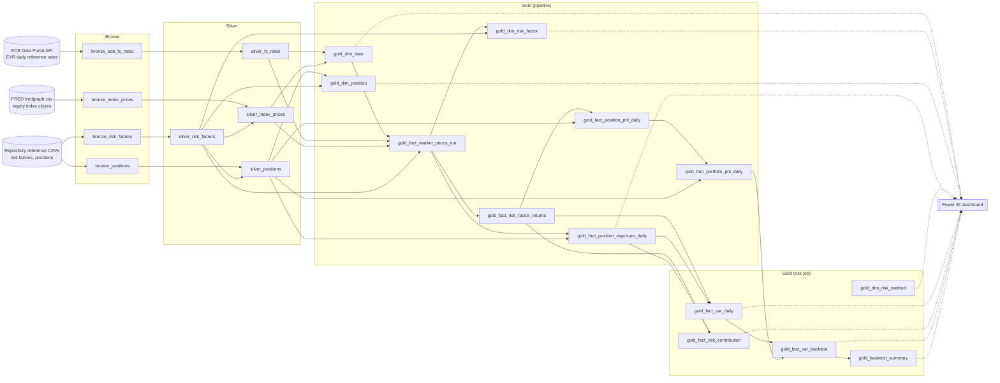

<!-- Generated by scripts/build_docs.py. Do not edit by hand. -->

# Lineage

Every table in the lakehouse, where it comes from and what reads it. Unity Catalog also
captures column-level lineage at runtime for the pipeline models; the risk job records its
inputs in the `lineage.upstream` table property of each table it writes.

## Tables

| Table | Layer | Produced by | Reads from | Read by |
|---|---|---|---|---|
| `bronze_ecb_fx_rates` | bronze | pipeline: `src/pipeline/bronze/bronze_market_data.sql` | ECB Data Portal API, EXR daily reference rates | `silver_fx_rates` |
| `bronze_index_prices` | bronze | pipeline: `src/pipeline/bronze/bronze_market_data.sql` | FRED fredgraph.csv, equity index closes | `silver_index_prices` |
| `bronze_positions` | bronze | pipeline: `src/pipeline/bronze/bronze_reference_data.sql` | Repository reference CSVs, risk factors, positions | `silver_positions` |
| `bronze_risk_factors` | bronze | pipeline: `src/pipeline/bronze/bronze_reference_data.sql` | Repository reference CSVs, risk factors, positions | `silver_risk_factors` |
| `silver_fx_rates` | silver | pipeline: `src/pipeline/silver/silver_market_data.sql` | `bronze_ecb_fx_rates` | `gold_dim_date`, `gold_fact_market_prices_eur` |
| `silver_risk_factors` | silver | pipeline: `src/pipeline/silver/silver_reference_data.sql` | `bronze_risk_factors` | `gold_dim_position`, `gold_dim_risk_factor`, `gold_fact_market_prices_eur`, `silver_index_prices`, `silver_positions` |
| `silver_index_prices` | silver | pipeline: `src/pipeline/silver/silver_market_data.sql` | `bronze_index_prices`, `silver_risk_factors` | `gold_dim_date`, `gold_fact_market_prices_eur` |
| `gold_dim_date` | gold | pipeline: `src/pipeline/gold/gold_dimensions.sql` | `silver_fx_rates`, `silver_index_prices` | `gold_fact_market_prices_eur`, Power BI |
| `silver_positions` | silver | pipeline: `src/pipeline/silver/silver_reference_data.sql` | `bronze_positions`, `silver_risk_factors` | `gold_dim_position`, `gold_fact_portfolio_pnl_daily`, `gold_fact_position_exposure_daily`, `gold_fact_position_pnl_daily` |
| `gold_dim_position` | gold | pipeline: `src/pipeline/gold/gold_dimensions.sql` | `silver_positions`, `silver_risk_factors` | Power BI |
| `gold_fact_market_prices_eur` | gold | pipeline: `src/pipeline/gold/gold_market_data.sql` | `gold_dim_date`, `silver_fx_rates`, `silver_index_prices`, `silver_risk_factors` | `gold_dim_risk_factor`, `gold_fact_position_exposure_daily`, `gold_fact_risk_factor_returns` |
| `gold_dim_risk_factor` | gold | pipeline: `src/pipeline/gold/gold_dimensions.sql` | `gold_fact_market_prices_eur`, `silver_risk_factors` | Power BI |
| `gold_fact_risk_factor_returns` | gold | pipeline: `src/pipeline/gold/gold_market_data.sql` | `gold_fact_market_prices_eur` | `gold_fact_position_pnl_daily`, `gold_fact_risk_contribution`, `gold_fact_var_daily` |
| `gold_fact_position_pnl_daily` | gold | pipeline: `src/pipeline/gold/gold_exposure_pnl.sql` | `gold_fact_risk_factor_returns`, `silver_positions` | `gold_fact_portfolio_pnl_daily` |
| `gold_fact_portfolio_pnl_daily` | gold | pipeline: `src/pipeline/gold/gold_exposure_pnl.sql` | `gold_fact_position_pnl_daily`, `silver_positions` | `gold_fact_var_backtest` |
| `gold_fact_position_exposure_daily` | gold | pipeline: `src/pipeline/gold/gold_exposure_pnl.sql` | `gold_fact_market_prices_eur`, `silver_positions` | `gold_fact_risk_contribution`, `gold_fact_var_daily`, Power BI |
| `gold_dim_risk_method` | gold | risk job: `src/market_risk/jobs/compute_risk.py` |  | Power BI |
| `gold_fact_var_daily` | gold | risk job: `src/market_risk/jobs/compute_risk.py` | `gold_fact_risk_factor_returns`, `gold_fact_position_exposure_daily` | `gold_fact_var_backtest`, Power BI |
| `gold_fact_risk_contribution` | gold | risk job: `src/market_risk/jobs/compute_risk.py` | `gold_fact_risk_factor_returns`, `gold_fact_position_exposure_daily` | Power BI |
| `gold_fact_var_backtest` | gold | risk job: `src/market_risk/jobs/compute_risk.py` | `gold_fact_var_daily`, `gold_fact_portfolio_pnl_daily` | `gold_backtest_summary`, Power BI |
| `gold_backtest_summary` | gold | risk job: `src/market_risk/jobs/compute_risk.py` | `gold_fact_var_backtest` | Power BI |
